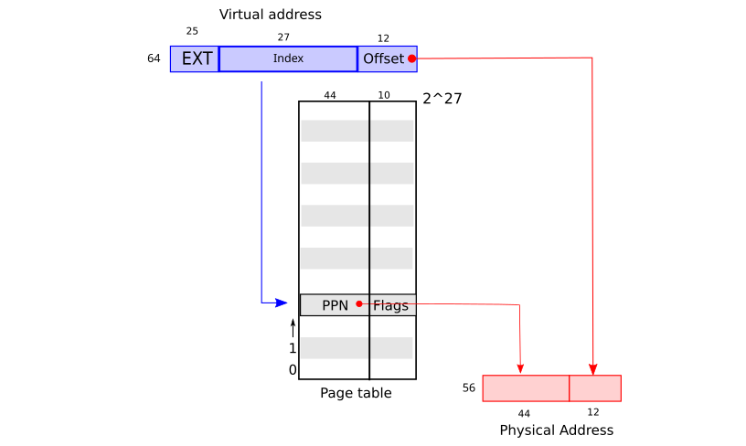
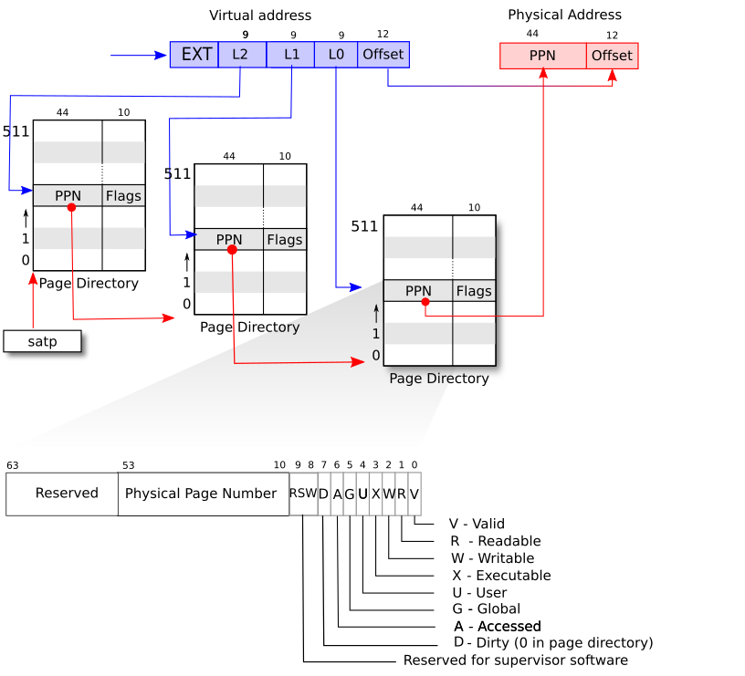

## 第三章：页表

通过页表机制，操作系统为每个进程提供各自私有的地址空间和内存。页表决定了内存地址的含义，以及物理内存的哪些部分可以被访问。它们允许 xv6 隔离不同进程的地址空间，并将这些地址空间复用到同一块物理内存上。页表提供了一层间接，使操作系统能够实现许多有用的技巧。Xv6 实现了其中几项：在多个地址空间中映射同一内存（一个 trampoline 页），用一个未映射的页守护内核栈和用户栈，以及惰性分配用户堆内存。本章其余部分将解释 RISC-V 硬件提供的页表以及 xv6 如何使用它们。

### 3.1 分页硬件

提醒一下，RISC-V 指令（包括用户和内核）操作的是虚拟地址。机器的 RAM，或者说物理内存，是用物理地址来索引的。RISC-V 的页表硬件通过把每个虚拟地址映射到一个物理地址，将这两种地址联系起来。



*图 3.1：扁平页表把虚拟地址映射到物理地址的抽象视图。*

Xv6 使用 RISC-V 的 Sv39 模式，这意味着只会使用 64 位虚拟地址的低 39 位；高 25 位没有被使用。在这种 Sv39 配置中，一个 RISC-V 页表在逻辑上是一个由 2²⁷（134,217,728）个**页表项（Page Table Entry，PTE）**组成的数组。每个 PTE 包含一个 44 位的**物理页号（Physical Page Number，PPN）**和一些标志位。分页硬件用这 39 位中的高 27 位索引页表找到一个 PTE，从而转换一个虚拟地址，并生成一个 56 位的物理地址：它的高 44 位来自 PTE 中的 PPN，低 12 位则从原来的虚拟地址复制而来。图 3.1 展示了这个过程，它把页表逻辑上看成一个简单的 PTE 数组（RISC-V 的页表实际上是一棵树，更完整的描述见图 3.2）。页表让操作系统能够以 4096（2¹²）字节的对齐块为粒度，控制虚拟地址到物理地址的转换。这样的一个块称为一个页。



*图 3.2：RISC-V 地址转换细节。*

RISC-V 的设计为虚拟地址和物理地址的扩展都留出了余地。如果需要更大的虚拟地址空间，RISC-V 还支持 Sv48 模式，它使用 48 位虚拟地址（[Waterman et al. 2024 [17]](references.md#ref17)）。物理地址也有增长空间：PTE 格式中物理页号还有再增长 10 位的余地。RISC-V 的设计者根据技术预测选定了地址的位宽。2⁴⁸ 字节是 262,144 GB，比当今任何应用可能用到的用户虚拟地址空间都大得多。2⁵⁶ 字节的物理地址空间是 65,536 TB，比目前任何计算机所能配备的 RAM 都多得多。

如图 3.2 所示，RISC-V CPU 的页表以三层树的形式存储在物理内存中。树的根是一个 4096 字节的页表页，其中包含 512 个 PTE，这些 PTE 给出树中下一级页表页的物理地址。下一级的每个页都包含 512 个 PTE，指向树中最后一级。分页硬件用 27 位中的高 9 位选择根页表页中的 PTE，用中间 9 位选择树中下一级页表页中的 PTE，用低 9 位选择最终的那个 PTE。（在 Sv48 的 RISC-V 中，页表有四层，虚拟地址的第 39 到 47 位用于索引最高一层。）

如果转换一个地址所需的三个 PTE 中任何一个不存在，分页硬件就会引发一个**缺页异常（page-fault exception）**，交给内核来处理这个缺页异常（见第 4 章和第 5 章）。

与图 3.1 的单层设计相比，图 3.2 的三层结构提供了一种更节省内存的 PTE 记录方式。在大范围虚拟地址没有映射这种常见情况下，三层结构可以省略整个页目录。例如，如果一个应用只使用从地址零开始的少数几页，那么顶层页目录的第 1 到 511 项都是无效的，内核不必为这 511 个中间页目录分配页。进一步说，内核也不必为这 511 个中间页目录所对应的底层页目录分配页。因此在这个例子中，三层设计为中间页目录节省了 511 页，为底层页目录节省了 511×512 页。

CPU 在执行 load 或 store 指令时会在硬件中遍历这个三层结构，但三层结构的一个潜在缺点是：CPU 必须从内存读取三个 PTE，才能把 load/store 指令中的虚拟地址转换成物理地址。为了避免从物理内存读取 PTE 的开销，RISC-V CPU 把页表项缓存到**翻译后备缓冲器（Translation Look-aside Buffer，TLB）**中。

每个 PTE 都包含标志位，用于告诉分页硬件相关的虚拟地址允许怎样使用。`PTE_V` 表示该 PTE 是否存在：如果没有设置，对该页的引用会引起缺页异常（即不允许）。`PTE_R` 控制是否允许指令读取该页。`PTE_W` 控制是否允许指令向该页写入。`PTE_X` 控制 CPU 是否可以将页面的内容解释为指令并执行。`PTE_U` 控制用户模式下的指令是否允许访问该页；如果不设置 `PTE_U`，该 PTE 只能在监管模式（supervisor mode）下使用。图 3.2 显示了标志位在 PTE 中的位置。标志位以及与分页硬件相关的其他数据结构定义在 [`kernel/riscv.h`](https://github.com/mit-pdos/xv6-riscv/blob/riscv/kernel/riscv.h) 中。

要告诉 CPU 使用一个页表，内核必须把根页表页的物理地址写入 `satp` 寄存器。CPU 会用其 `satp` 所指向的页表翻译后续指令产生的所有地址。每个 CPU 都有自己的 `satp`，这样不同的 CPU 可以运行不同的进程，每个进程都有由自己的页表描述的私有地址空间。

从内核的角度看，页表是存放在内存中的数据，内核用创建和修改树状数据结构时常见的代码来创建和修改页表。

关于本书中术语的几点说明。**物理内存**指的是 RAM 中的存储单元。物理内存的一个字节有一个地址，称为**物理地址**。解引用地址的指令（如 load、store、跳转和函数调用）只使用虚拟地址，分页硬件把这些虚拟地址翻译成物理地址，然后交给 RAM 硬件去读写存储。**地址空间**是在给定页表中有效的虚拟地址的集合；每个 xv6 进程都有一个单独的用户地址空间，xv6 内核也有自己的地址空间。**用户内存**指的是一个进程的用户地址空间，加上页表允许该进程访问的物理内存。**虚拟内存**指的是与页表管理相关的各种思想和技术，以及利用它们实现隔离等目标的方法。


*图 3.3：左侧是 xv6 的内核虚拟地址空间，RWX 指 PTE 的读、写和执行权限；右侧是 xv6 期望看到的 RISC-V 物理地址空间。*

### 3.2 内核地址空间

启动时，xv6 创建一个单独的页表来描述内核的地址空间。内核配置其地址空间的布局，使自己能够在可预测的虚拟地址上访问物理内存和各种硬件资源。图 3.3 显示了这种布局如何将内核虚拟地址映射到物理地址。文件 [`kernel/memlayout.h`](https://github.com/mit-pdos/xv6-riscv/blob/riscv/kernel/memlayout.h) 声明了 xv6 内核内存布局的常量。

QEMU 模拟的计算机包含 RAM（物理内存），从物理地址 `0x80000000` 开始，至少延伸到 `0x88000000`，xv6 称之为 `PHYSTOP`。QEMU 模拟还包括 I/O 设备，如磁盘接口。QEMU 将设备接口作为**内存映射（memory-mapped）**的控制寄存器暴露给软件，这些寄存器位于物理地址空间的 `0x80000000` 以下。内核可以通过读取/写入这些特殊的物理地址与设备交互；这种读取和写入与设备硬件而不是与 RAM 通信。第 4 章解释了 xv6 如何与设备交互。

内核把所有物理 RAM 和设备寄存器映射到与物理地址相同的虚拟地址上。这称为“直接映射”，它让内核只需读写虚拟地址 x 就能读写物理地址 x。内核代码本身在虚拟地址空间和物理内存中都位于 `KERNBASE=0x80000000`。当 [`kfork`](https://github.com/mit-pdos/xv6-riscv/blob/riscv/kernel/proc.c#L259) 为子进程分配用户内存时，分配器返回该内存的物理地址；`kfork` 在把父进程的用户内存复制到子进程时，直接把这个地址当作虚拟地址使用。

有几个内核虚拟地址不是直接映射的：

- trampoline 页。它被映射在虚拟地址空间的顶端；用户页表也有同样的映射。第 4 章讨论 trampoline 页的作用，但我们在这里看到页表的一个有趣用例：一个（存放 trampoline 代码的）物理页在内核的虚拟地址空间中被映射了两次，一次在虚拟地址空间的顶端，一次是直接映射。

- 内核栈页。每个进程都有自己的内核栈，它被映射到一个较高的内核虚拟地址，这样 xv6 就可以在它下方留出一个未映射的**保护页（guard page）**。保护页的 PTE 是无效的（即没有设置 `PTE_V`），因此如果内核溢出某一个内核栈，很可能会引发缺页异常，内核会 panic。没有保护页的话，栈溢出会覆盖其他内核内存，导致不正确的操作。崩溃（panic）反而更好。

内核通过高地址映射使用它的各个栈，但每个栈也可以通过直接映射的地址被内核访问。另一种设计可能只保留直接映射，并在直接映射的地址上使用这些栈。不过在这种安排下，提供保护页就得取消映射一些本来指向物理内存的虚拟地址，而这些地址之后会很难使用。

内核把 trampoline 和内核 text（可执行程序的代码段）的页映射为带有 `PTE_R` 和 `PTE_X` 权限，但不带 `PTE_W` 权限。内核把其他页映射为带有 `PTE_R` 和 `PTE_W` 权限，但不带 `PTE_X` 权限。保护页的映射是无效的。这些受限权限的目的是帮助发现那些以意外方式访问页的内核缺陷，比如内核代码意外地试图覆盖内核指令。

内核创建唯一一个内核页表，所有 CPU 在内核中执行时都使用它。xv6 在初次创建之后不再修改内核页表。

### 3.3 代码：创建地址空间

请先阅读 [`kernel/vm.c`](https://github.com/mit-pdos/xv6-riscv/blob/riscv/kernel/vm.c) 中直到 `mappages()` 结束的部分。

大部分用于操作地址空间和页表的 xv6 代码都在 [`vm.c`](https://github.com/mit-pdos/xv6-riscv/blob/riscv/kernel/vm.c) 中。核心数据结构是 `pagetable_t`，它实际上是一个指向 RISC-V 根页表页的指针；`pagetable_t` 可以是内核页表，也可以是某个进程的页表。核心函数是 `walk` 和 `mappages`，前者查找一个虚拟地址对应的 PTE，后者为新的映射安装 PTE。以 `kvm` 开头的函数操作内核页表；以 `uvm` 开头的函数操作某个用户页表；其他函数则两者通用。`copyout` 和 `copyin` 在作为系统调用参数给出的用户虚拟地址之间复制数据；它们位于 `vm.c` 中，因为它们需要显式转换这些地址，才能找到对应的物理内存。

在启动序列的早期，`main` 调用 [`kvminit`](https://github.com/mit-pdos/xv6-riscv/blob/riscv/kernel/vm.c#L67) 用 [`kvmmake`](https://github.com/mit-pdos/xv6-riscv/blob/riscv/kernel/vm.c#L22) 创建内核页表。这个调用发生在 xv6 在 RISC-V 上启用分页之前，所以地址直接指向物理内存。`kvmmake` 首先分配一页物理内存来存放根页表页，然后调用 `kvmmap` 安装内核需要的转换。这些转换包括内核的指令和数据、直到 `PHYSTOP` 的物理内存，以及实际上是设备的内存范围。[`proc_mapstacks`](https://github.com/mit-pdos/xv6-riscv/blob/riscv/kernel/proc.c#L33) 为每个进程分配一个内核栈，它调用 `kvmmap` 把每个栈映射到 `KSTACK` 生成的虚拟地址上，这就为无效的栈保护页留出了空间。

[`kvmmap`](https://github.com/mit-pdos/xv6-riscv/blob/riscv/kernel/vm.c#L59) 调用 [`mappages`](https://github.com/mit-pdos/xv6-riscv/blob/riscv/kernel/vm.c#L147)，后者把一个范围内的虚拟地址映射到一段相应的物理地址，并把这些映射安装进一个页表。它按页间隔，对范围内的每个虚拟地址分别进行映射。对于每个要映射的虚拟地址，`mappages` 调用 `walk` 找到该地址对应 PTE 的地址，然后初始化这个 PTE，使其持有相关的物理页号、所需的权限（`PTE_W`、`PTE_X` 和/或 `PTE_R`），以及标记该 PTE 有效的 `PTE_V`（[vm.c:168](https://github.com/mit-pdos/xv6-riscv/blob/riscv/kernel/vm.c#L168)）。

[`walk`](https://github.com/mit-pdos/xv6-riscv/blob/riscv/kernel/vm.c#L99) 模仿 RISC-V 分页硬件查找一个虚拟地址的 PTE（见图 3.2）。`walk` 逐级下降页表树，用每一级的 9 位虚拟地址索引到相应的页目录页。在每一级，它要么找到下一级页目录页的 PTE，要么找到最后一级页的 PTE（[vm.c:105](https://github.com/mit-pdos/xv6-riscv/blob/riscv/kernel/vm.c#L105)）。如果第一级或第二级页目录页中的某个 PTE 无效，说明所需的目录页还没有被分配；如果 `alloc` 参数被设置，`walk` 会分配一个新的页表页，并把它的物理地址放入该 PTE。它返回树中最低层那个 PTE 的地址（[vm.c:115](https://github.com/mit-pdos/xv6-riscv/blob/riscv/kernel/vm.c#L115)）。

上面的代码依赖于物理内存被直接映射到内核虚拟地址空间。例如，`walk` 在下降页表各级时，会从 PTE 中取出下一级页表的（物理）地址（[vm.c:107](https://github.com/mit-pdos/xv6-riscv/blob/riscv/kernel/vm.c#L107)），然后把这个地址当作虚拟地址，去获取下一级的 PTE（[vm.c:105](https://github.com/mit-pdos/xv6-riscv/blob/riscv/kernel/vm.c#L105)）。

在每个 CPU 上，`main` 调用 [`kvminithart`](https://github.com/mit-pdos/xv6-riscv/blob/riscv/kernel/vm.c#L75) 来安装内核页表，它把根页表页的物理地址放入该 CPU 的 `satp` 寄存器。在这之后，CPU 就使用内核页表翻译地址。内核仍然能正确执行，因为内核页表是直接映射的，所以在这一改变前后，地址都指向 RAM 中的同一位置。

每个 RISC-V CPU 都会在 TLB 中缓存页表项，当 xv6 改变页表时，必须告诉 CPU 使相应的缓存 TLB 项无效。否则，在之后的某个时刻，TLB 可能会使用一个旧的缓存映射，指向一个在此期间已被分配给另一个进程的物理页，结果一个进程可能得以在另一个进程的内存上乱写。RISC-V 有一条指令 `sfence.vma`，用于刷新当前 CPU 的 TLB。xv6 在 `kvminithart` 中重新加载 `satp` 寄存器之后执行 `sfence.vma`，并在 `uservec` 和 `userret` 的 trampoline 代码中执行 `sfence.vma`。

在改变 `satp` 之前也需要执行 `sfence.vma`，以等待所有尚未完成的 load 和 store 完成。这个等待确保此前对页表的更新已经完成，并确保此前的 load 和 store 使用的是旧页表而不是新页表。

### 3.4 物理内存分配

内核必须在运行时为页表、用户内存、内核栈和管道缓冲区分配和释放物理内存。

xv6 使用内核结束处到 `PHYSTOP` 之间的物理内存进行运行时分配。它一次分配和释放整页 4096 字节的页面。它通过把一个链表穿在空闲页自身中来记录哪些页是空闲的。分配就是从链表中取出一页；释放就是把释放的页加回链表。

请阅读 [`kernel/kalloc.c`](https://github.com/mit-pdos/xv6-riscv/blob/riscv/kernel/kalloc.c)。

### 3.5 代码：物理内存分配器

分配器位于 [`kalloc.c`](https://github.com/mit-pdos/xv6-riscv/blob/riscv/kernel/kalloc.c) 中。分配器的数据结构是一个可供分配的物理内存页的**空闲链表**。每个空闲页的“next”指针存放在一个 [`struct run`](https://github.com/mit-pdos/xv6-riscv/blob/riscv/kernel/kalloc.c#L17) 中。分配器把每个空闲页的 `run` 结构体放在该空闲页自身里，因为该页空闲时没有别的东西存放在那里。空闲链表由一把自旋锁保护（[kalloc.c:21-24](https://github.com/mit-pdos/xv6-riscv/blob/riscv/kernel/kalloc.c#L21-L24)）。链表和锁被包裹在一个结构体中，以明确锁保护的是结构体中的字段。现在请忽略锁以及对 `acquire` 和 `release` 的调用；第 7 章将详细研究锁。

函数 `main` 调用 `kinit` 来初始化分配器（[kalloc.c:27](https://github.com/mit-pdos/xv6-riscv/blob/riscv/kernel/kalloc.c#L27)）。`kinit` 初始化空闲链表，使其保存内核结束处到 `PHYSTOP` 之间的每一个物理 RAM 页。xv6 本应通过解析硬件提供的配置信息来确定有多少物理内存可用，但实际上它假设机器有 128 兆字节的 RAM。`kinit` 调用 `freerange` 通过对每一页调用 `kfree` 把内存加入空闲链表。一个 PTE 只能引用按 4096 字节边界对齐（是 4096 的倍数）的物理地址，因此 `freerange` 用 `PGROUNDUP` 确保它只释放对齐的物理地址。分配器一开始没有任何内存；这些对 `kfree` 的调用给了它一些可管理的内存。

分配器有时把地址当作整数来进行运算（例如在 `freerange` 中遍历所有页），有时把地址当作指针来读写内存（例如操作存放在每个页中的 `run` 结构体）；这种地址的双重用途是分配器代码中充满 C 类型转换的主要原因。

函数 [`kfree`](https://github.com/mit-pdos/xv6-riscv/blob/riscv/kernel/kalloc.c#L47) 首先把被释放内存中的每个字节设为值 1。这会使释放内存之后仍使用该内存的代码（使用“悬空引用”）读到垃圾而不是原来有效的内容；希望这能让这类代码更快地崩溃。然后 `kfree` 把该页加到空闲链表的头部：它把 `pa` 转换成指向 `struct run` 的指针，把空闲链表的原头部记录在 `r->next` 中，并令空闲链表等于 `r`。`kalloc` 取出并返回空闲链表中的第一个元素。

### 3.6 进程地址空间

每个进程都有自己的页表，当 xv6 在进程间切换时，也会改变页表。图 3.4 比图 2.3 更详细地展示了一个进程的地址空间。一个进程的用户地址空间从 0 开始，原则上到 `MAXVA`（`0x4000000000`）（[riscv.h:417](https://github.com/mit-pdos/xv6-riscv/blob/riscv/kernel/riscv.h#L417)）结束，但实际上其中只有一小部分被映射到物理内存。

一个进程的地址空间由这些页组成：存放程序 text 的页（xv6 用 `PTE_R`、`PTE_X` 和 `PTE_U` 权限映射它们）、存放程序已初始化数据的页、一个用作栈的页，以及用作堆的若干页。xv6 用 `PTE_R`、`PTE_W` 和 `PTE_U` 权限映射数据、栈和堆。

在用户地址空间内使用权限，是加固用户进程的一种常见技术。如果 text 被带 `PTE_W` 映射，进程就可能意外修改自己的程序；例如，编程错误可能让程序写入一个空指针，修改地址 0 处的指令，然后继续运行，也许会造成更大的破坏。为了立即发现这类错误，xv6 映射 text 时不带 `PTE_W`；如果程序意外地试图向地址 0 写入，硬件会拒绝执行这次写入并引发缺页异常（见第 4 章）。随后内核会杀死该进程，并打印一条有用的信息，以便开发者定位问题。

同样，映射数据时不带 `PTE_X`，用户程序就无法意外地跳转到程序数据中的某个地址并从那里开始执行。

在现实世界中，通过仔细设置权限来加固进程，也有助于防御安全攻击。攻击者可能向程序（例如一个 Web 服务器）提供精心构造的输入，触发程序中的一个缺陷，希望把这个缺陷变成一次利用（[One, n.d. [12]](references.md#ref12)）。仔细设置权限，以及使用随机的用户地址空间布局等技术，会使这类攻击更难实施。

栈只有一页，图中显示的是由 `exec` 系统调用创建的初始内容。包含命令行参数的字符串以及指向它们的指针数组位于栈的最顶端。紧挨其下方是一些值，它们让程序可以从 `main` 开始执行，就像函数 `main(argc, argv)` 刚刚被调用过一样。

为了检测用户栈溢出所分配的栈内存，xv6 在栈的正下方放置一个不可访问的保护页，做法是清除 `PTE_U` 标志。如果用户栈溢出，进程试图使用栈下方的地址，硬件会产生缺页异常，因为对运行在用户模式的程序来说保护页不可访问。现实世界中的操作系统则可能在用户栈溢出时自动为它分配更多内存。

我们在这里看到了几个使用页表的好例子。第一，不同进程的页表把用户地址翻译到物理内存中不同的页，因此每个进程都有私有的用户内存。第二，每个进程都认为自己的内存是从 0 开始的连续虚拟地址，而该进程的物理内存可以是不连续的。第三，内核在用户地址空间的顶端映射了一个带 trampoline 代码的页（不带 `PTE_U`），因此一个物理页会出现在所有地址空间中，但只能由内核使用。


*图 3.4：进程的用户地址空间及其初始栈。*

### 3.7 代码：exec

请阅读 [`kernel/exec.c`](https://github.com/mit-pdos/xv6-riscv/blob/riscv/kernel/exec.c) 和 [`kernel/vm.c`](https://github.com/mit-pdos/xv6-riscv/blob/riscv/kernel/vm.c) 中从 `uvmcreate()` 开始的部分。

`exec` 是一个系统调用，它用一个从文件中读出的数据替换进程的用户地址空间，这个文件称为二进制文件或可执行文件。二进制文件通常是编译器和链接器的输出，包含机器指令和程序数据。[`kexec`](https://github.com/mit-pdos/xv6-riscv/blob/riscv/kernel/exec.c#L28) 是 `exec` 在内核中的内部实现，它用 [`namei`](https://github.com/mit-pdos/xv6-riscv/blob/riscv/kernel/exec.c#L42) 打开名为 `path` 的二进制文件，第 10 章会解释 `namei`。然后，它读取 ELF 头。xv6 的二进制文件采用广泛使用的 **ELF 格式**，定义在 [`kernel/elf.h`](https://github.com/mit-pdos/xv6-riscv/blob/riscv/kernel/elf.h) 中。一个 ELF 二进制文件由一个 ELF 头 [`struct elfhdr`](https://github.com/mit-pdos/xv6-riscv/blob/riscv/kernel/elf.h#L6) 和随后的一串程序段头 [`struct proghdr`](https://github.com/mit-pdos/xv6-riscv/blob/riscv/kernel/elf.h#L25) 组成。每个 `proghdr` 描述应用的一个必须加载到内存中的段；xv6 程序有两个程序段头：一个用于指令，一个用于数据。

第一步是快速检查文件大概率包含一个 ELF 二进制文件。一个 ELF 二进制文件以四个字节的“魔法数字” `0x7F`、`E'`、`L'`、`F'` 或 [`ELF_MAGIC`](https://github.com/mit-pdos/xv6-riscv/blob/riscv/kernel/elf.h#L3) 开始。如果 ELF 头有正确的魔法数字，`kexec` 就认为该二进制文件格式正确。

`kexec` 用 [`proc_pagetable`](https://github.com/mit-pdos/xv6-riscv/blob/riscv/kernel/exec.c#L56) 分配一个没有用户映射的新页表，用 [`uvmalloc`](https://github.com/mit-pdos/xv6-riscv/blob/riscv/kernel/exec.c#L72) 为每个 ELF 段分配内存，并用 [`loadseg`](https://github.com/mit-pdos/xv6-riscv/blob/riscv/kernel/exec.c#L76) 把每个段加载到内存中。`loadseg` 用 `walkaddr` 找到已分配内存的物理地址，以便在那里写入 ELF 段的每一页，并用 `readi` 从文件中读取。

用 `kexec` 创建的第一个用户程序 `/init` 的程序段头看起来是这样的：

```sh
# objdump -p user/_init

user/_init:     file format elf64-little

Program Header:
0x70000003 off    0x0000000000006bb0 vaddr 0x0000000000000000
                                       paddr 0x0000000000000000 align 2**0
         filesz 0x000000000000004a memsz 0x0000000000000000 flags r--
    LOAD off    0x0000000000001000 vaddr 0x0000000000000000
                                       paddr 0x0000000000000000 align 2**12
         filesz 0x0000000000001000 memsz 0x0000000000001000 flags r-x
    LOAD off    0x0000000000002000 vaddr 0x0000000000001000
                                       paddr 0x0000000000001000 align 2**12
         filesz 0x0000000000000010 memsz 0x0000000000000030 flags rw-
   STACK off    0x0000000000000000 vaddr 0x0000000000000000
                                       paddr 0x0000000000000000 align 2**4
         filesz 0x0000000000000000 memsz 0x0000000000000000 flags rw-
```

可以看到，text 段应当从文件中偏移 0x1000 处的内容加载到内存的虚拟地址 0x0 处（不带写权限）。还可以看到，数据应当加载到地址 0x1000 处，该地址位于页边界上，并且不带执行权限。

程序段头的 `filesz` 可能小于 `memsz`，说明它们之间的空隙应当用 0 填充（用于 C 语言的全局变量），而不是从文件中读取。对于 `/init`，数据段的 `filesz` 是 0x10 字节，`memsz` 是 0x30 字节，因此 `uvmalloc` 分配了足够的物理内存来容纳 0x30 字节，但只从文件 `/init` 中读取 0x10 字节。

现在 `kexec` 分配并初始化用户栈。它只分配一个栈页。`kexec` 逐个把参数字符串复制到栈的顶端，并把指向它们的指针记录在 `ustack` 中。它在将要传给 `main` 的 `argv` 列表末尾放一个空指针。`argc` 和 `argv` 的值通过系统调用返回路径传给 `main`：`argc` 通过系统调用的返回值传递，返回值放在 `a0` 中；`argv` 通过进程 trapframe 的 `a1` 项传递。

`kexec` 在栈页正下方放置一个不可访问的页，这样试图使用多个页的程序就会出错。这个不可访问的页还让 `kexec` 能够处理过大的参数；在这种情况下，`kexec` 用来把参数复制到栈的 [`copyout`](https://github.com/mit-pdos/xv6-riscv/blob/riscv/kernel/vm.c#L345) 函数会注意到目标页不可访问，并返回 -1。

在准备新的内存映像的过程中，如果 `kexec` 检测到错误（比如无效的程序段），它就跳转到标签 `bad`，释放新的映像，并返回 -1。`kexec` 必须等到确信系统调用会成功之后才释放旧映像：如果旧映像已经消失，系统调用就无法向它返回 -1。`kexec` 中唯一的错误情况发生在创建映像的过程中。一旦映像完成，`kexec` 就可以提交到新的页表（[exec.c:134](https://github.com/mit-pdos/xv6-riscv/blob/riscv/kernel/exec.c#L134)）并释放旧的页表（[exec.c:138](https://github.com/mit-pdos/xv6-riscv/blob/riscv/kernel/exec.c#L138)）。

`exec` 系统调用把 ELF 文件中的字节加载到该 ELF 文件指定的内存地址。用户或进程可以把任意地址放进 ELF 文件。因此 `exec` 是有风险的，因为 ELF 文件中的地址可能意外地或故意地指向内核。对于一个不够小心的内核，后果可能从崩溃一直到内核隔离机制被恶意颠覆（即一个安全漏洞）。xv6 执行了一些检查来避免这些风险。例如 `if(ph.vaddr + ph.memsz < ph.vaddr)` 检查这个和是否溢出一个 64 位整数。危险在于，用户可以构造一个 ELF 二进制文件，其 `ph.vaddr` 指向用户选定的地址，而 `ph.memsz` 足够大，使这个和溢出到 0x1000，看起来像一个有效值。在旧版本的 xv6 中，用户地址空间也包含内核（但在用户模式下不可读/写），用户可以选择一个对应内核内存的地址，从而把 ELF 二进制文件中的数据复制到内核中。在 RISC-V 版本的 xv6 中这不可能发生，因为内核有自己单独的页表；`loadseg` 加载到进程的页表，而不是内核的页表。

内核开发者很容易漏掉一个关键的检查，现实中的内核有很长的漏检查历史，这些缺失的检查可能被用户程序利用来获得内核特权。xv6 很可能没有完整地验证提供给内核的用户级数据，恶意用户程序也许能利用这一点绕过 xv6 的隔离。

### 3.8 现实世界

像大多数操作系统一样，xv6 使用分页硬件进行内存保护和映射。大多数操作系统对分页的使用比 xv6 复杂得多，它们把分页和缺页异常结合起来，我们将在第 4 章讨论这一点。

Xv6 的内核在虚拟地址和物理地址之间使用直接映射，并且假设地址 0x80000000 处有物理 RAM，内核期望被加载到那里，这些假设简化了 xv6。这在 QEMU 上是可行的，但在真实硬件上它被证明是一个糟糕的想法；真实硬件把 RAM 和设备放在不可预测的物理地址上，因此（例如）0x80000000 处可能没有 RAM，而 xv6 期望能够在那里存放内核。更严肃的内核设计会利用页表，把任意的硬件物理内存布局转换成可预测的内核虚拟地址布局。

RISC-V 支持物理地址级别的保护，但 xv6 没有使用这个特性。

在有大量内存的机器上，使用 RISC-V 对“大页”的支持可能是有意义的。当物理内存很小时，小页是有意义的，这样可以按精细的粒度进行分配和换出到磁盘。例如，如果一个程序只使用 8 千字节的内存，却分给它一个整整 4 兆字节的大物理页，那就是浪费。更大的页在有大量 RAM 的机器上有意义，并且可能降低页表操作的开销。

为了避免在改变页表时刷新整个 TLB，RISC-V CPU 可能支持地址空间标识符（address space identifiers，ASID）（[Waterman et al. 2024 [17]](references.md#ref17)）。这样内核就可以只刷新某个特定地址空间的 TLB 项。xv6 没有使用这个特性。

xv6 内核缺少一个类似 `malloc` 的分配器来为小对象提供内存，这使得内核无法使用需要动态分配的复杂数据结构。一个更精细的内核很可能会分配许多不同大小的小块，而不是（像 xv6 那样）只分配 4096 字节的块；真正的内核分配器需要同时处理小块分配和大块分配。

内存分配是一个经久不衰的热门话题，基本问题是有效利用有限的内存，以及为未来未知的请求做好准备（[Knuth 1997 [6]](references.md#ref6)）。今天人们更关心速度，而不是空间效率。

### 3.9 练习

1. 解析 RISC-V 的设备树（device tree），找出计算机拥有多少物理内存。
2. 函数 `copyin` 和 `copyinstr` 在软件中遍历用户页表。设置内核页表，使内核拥有用户程序的映射，这样 `copyin` 和 `copyinstr` 就可以用 `memcpy` 把系统调用参数复制到内核空间，而由硬件完成页表遍历。
3. 修改 xv6，使内核使用大页。
4. Unix 的 `exec` 实现传统上包含对 shell 脚本的特殊处理。如果要执行的文件以文本 `#!` 开头，那么第一行就被看作运行该文件所用的解释程序。例如，如果调用 `exec` 运行 `myprog` `arg1`，而 `myprog` 的第一行是 `#!/interp`，那么 `exec` 就用命令行 `/interp` `myprog` `arg1` 运行 `/interp`。在 xv6 中实现对这个约定的支持。
5. 为内核实现地址空间布局随机化。
